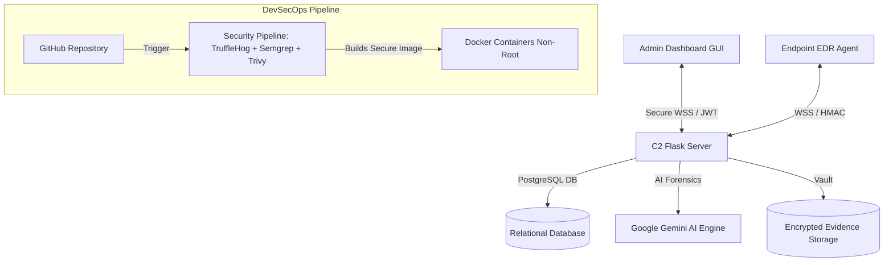

# 🛡️ FileTrack EDR & C2 Platform
> **Advanced Honeyfile-Based Endpoint Detection, Response & Command-and-Control System**
> *Real-Time WSS Communication • AI-Powered Forensics • Secure DevOps & Cloud Infrastructure*

---

## 🌟 1. Core Project Concept
**FileTrack** is an enterprise-grade, end-to-end Endpoint Detection and Response (EDR) platform designed for proactive threat detection and automated incident containment. It relies on a strategic **Honeyfile (Decoy Files)** architecture deployed on target endpoints.

When an unauthorized process, attacker, or ransomware strain interacts with or modifies a protected decoy file, the endpoint **Agent** instantly detects the breach, triggers automated remediation playbooks (such as access revocation and self-healing), and streams forensic telemetry to the central **C2 Server**. The entire ecosystem—Agent, C2 Server, and Admin Dashboard—communicates via **Secure WebSockets (WSS)** to achieve zero-latency command execution and real-time visibility.

---

## 🔄 2. The DevSecOps Transformation Journey
This project was engineered from the ground up applying rigorous **DevSecOps** and **Security-by-Design** principles. The table below outlines how the architecture evolved from a standard implementation to a hardened, production-ready security pipeline:

| Component / Layer | Legacy / Insecure State | Hardened DevSecOps State |
| :--- | :--- | :--- |
| **Secret Management** | Credentials and database URIs hardcoded directly into the source code. | Isolated configuration using environment variables (`os.getenv`) and strict `.env` file segregation. |
| **Containerization** | Default root privileges inside Docker containers, maximizing potential blast radius. | Hardened base images (`python:3.12-slim`) running under a non-root user (`serveredr_user`) to limit attack surfaces. |
| **Security Automation (CI/CD)** | Manual code deployment with no automated vulnerability scanning. | Automated GitHub Actions CI/CD pipeline enforcing **TruffleHog** (Secret Scanning), **Semgrep** (SAST), and **Trivy** (Container Scanning). |
| **Communication Protocol** | Slow and insecure HTTP polling loops prone to latency and sniffing. | Upgraded to **Secure WebSockets (WSS)** backed by token authentication and HMAC verification. |
| **Identity & Access Control** | Unrestricted administrative routing and unsecured dashboards. | Robust Role-Based Access Control (RBAC) enforced via **JWT Authentication** and secure token expiration rules. |

---

## 🏗️ 3. System Architecture
FileTrack is structured as a unified **Monorepo**, cleanly separating microservices while integrating a centralized security pipeline:



---

## 🚀 4. Core System Modules

### 🧩 A. Central C2 Server
* **Path:** `/server`
* **Stack:** Flask, PostgreSQL, Python 3.12, Socket.IO, PyJWT
* **Responsibilities:** Manages incoming agent heartbeats, processes threat telemetry, executes database migrations, issues administrative JWT tokens, and interfaces with the Google Gemini AI analysis engine.

### 🤖 B. Endpoint EDR Agent
* **Path:** `/agent`
* **Stack:** Watchdog, Psutil, OpenCV, Sounddevice, SocketIO Client
* **Responsibilities:** Continuously monitors deployed honeyfiles with low-noise filtering, executes OS-level containment (`icacls` permission lockdowns), and asynchronously captures forensic evidence (screenshots, process trees, audio/video dumps) without blocking core agent loops.

### 💻 C. Admin Security Operations Center (SOC) Console
* **Path:** `/admin`
* **Stack:** CustomTkinter, Python-SocketIO, Windows Native Toasts
* **Responsibilities:** Provides security analysts with real-time threat feeds, instant Windows toast notifications, remote file system browsing via WebSocket streams, and interactive AI forensic reports.

---

## 🐳 5. Secure Deployment & Containerization

To maintain environment parity between local testing and production cloud environments (such as Amazon Lightsail), the system is orchestrated using **Docker Compose**:

1. **Build and Launch Securely:**
   ```bash
   docker compose up --build -d
   ```
2. **Hardened Server `Dockerfile` Implementation:**
   ```dockerfile
   FROM python:3.12-slim
   WORKDIR /app
   COPY requirements.txt .
   RUN pip install --no-cache-dir -r requirements.txt
   COPY . .
   RUN useradd -m serveredr_user
   USER serveredr_user
   EXPOSE 5000
   CMD ["python", "app.py"]
   ```

---

## 🔒 6. Automated Security Pipeline (CI/CD)
Every code integration triggers an automated validation workflow designed to catch vulnerabilities prior to release:
* **TruffleHog:** Actively scans historical commits and working directories to prevent API key and credential leaks.
* **Semgrep:** Performs Static Application Security Testing (SAST) to detect code injection vulnerabilities, logic flaws, and misconfigurations.
* **Trivy:** Analyzes container images and dependency trees for known Common Vulnerabilities and Exposures (CVEs).

---

## 👨‍💻 Author
* **Youssif Ahmed Yehia** — *Lead DevSecOps Engineer & Security Developer*

---
*This repository serves as the definitive architecture reference and production showcase for the FileTrack EDR platform.*
