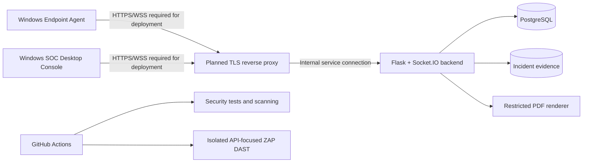
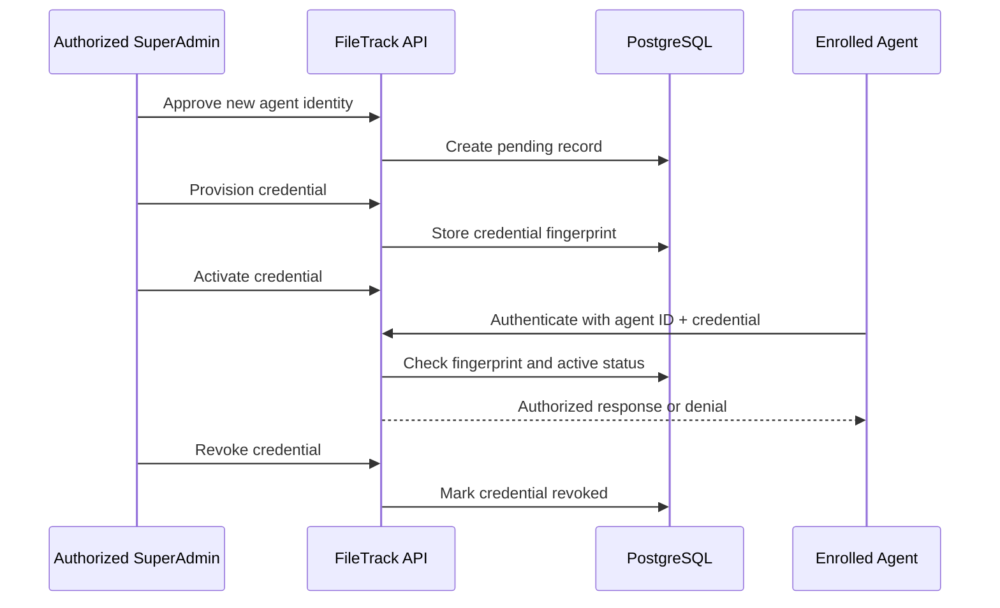

# 🛡️ FileTrack — Honeyfile-Based Endpoint Detection & Response

**FileTrack** is a Windows-focused endpoint detection and response (EDR) graduation project using **honeyfiles (decoy files)** to detect suspicious activity. Its monorepo includes a Windows endpoint agent, a Flask/Socket.IO backend with PostgreSQL, and a Windows SOC desktop console.

> **Project status — November 2026:** Active development and security hardening; **not production-ready**. The latest reviewed feature-branch security pipeline passed **15 GitHub checks** (7 security jobs on push, 7 on pull request, and one API-focused ZAP DAST job on pull request). The most recent local regression run reported **183 tests: 182 passed and 1 skipped**; a PostgreSQL enrollment lifecycle integration test was separately exercised against an isolated database and configured as mandatory in CI. These results apply to tested scenarios only. Do not install the agent on your primary workstation or expose an unprotected server to the internet.

## Overview

The endpoint agent monitors configured honeyfiles, reports incidents, and can collect evidence under configured policies. The server receives agent events, persists data to PostgreSQL, handles administrative operations, and produces restricted-resource PDF reports. The desktop SOC console supports investigation, agent visibility, and authorized response workflows.

Some response capabilities can change network connectivity, USB access, or filesystem permissions. **Use disposable Windows VMs and synthetic test data** for any live agent or containment exercise. Only test systems you own or are authorized to assess.

## Architecture



**Architecture note:** The TLS reverse proxy shown above is **planned, not deployed**. Current Docker Compose binds the backend to `127.0.0.1:5000` for local/CI testing over HTTP. Agent and admin clients request HTTPS and validate certificates, but end-to-end trusted TLS/WSS has **not** been validated. This diagram does not represent an internet-accessible production deployment.

## Repository layout

```text
.github/
  workflows/security-tests.yml     # Security regression + scanning jobs
  workflows/dast-zap.yml           # Isolated ZAP automation on pull requests
  zap-api-plan.yaml                # Safe API requestor / passive scan plan
admin/                              # Windows SOC desktop console
agent/                              # Windows endpoint agent and monitoring modules
server/                             # Flask-Socket.IO server, DB, PDF, container image
tests/                              # Mocked security tests and DB integration coverage
infra/k8s/                          # Kubernetes manifests (validation only)
docker-compose.yml                  # Isolated local backend + PostgreSQL
README.md
```

For component details see [server documentation](server/README.md), [agent documentation](agent/README.md), and [admin documentation](admin/README.md). Some component-level documentation may require corresponding updates.

## Security controls implemented

| Area | Current implementation / verified scope |
| --- | --- |
| **Agent identity** | Admin-controlled agent approval, credential provisioning, activation, and revocation; unique per-agent credentials instead of a shared time-window token. |
| **Credential checks** | Server-side HMAC credential fingerprints, tied to agent records and their active/revoked state. The `AGENT_CREDENTIAL_PEPPER` is server-side only. |
| **REST authorization** | Agent endpoints require the enrolled credential and associated identity; administrative enrollment operations have role/MFA/JWT controls. |
| **Socket.IO authorization** | Credential-bound agent sessions and authorization checks on covered events; wildcard Socket.IO CORS removed in favor of same-origin policy. A real client handshake integration test is still outstanding. |
| **Legacy auth removal** | Obsolete shared-token generation and verification code removed; regression tests guard against reintroduction. |
| **Evidence handling** | Incident-first evidence association, validation of filenames and incident ownership, size limits, and exclusive file publication. Filesystem and database operations are not one atomic transaction. |
| **PDF reports** | WeasyPrint renderer with external resource restrictions and bounded embedded image data. |
| **CI / supply chain** | Python security regression tests, Gitleaks, TruffleHog history scan, Semgrep, Python dependency auditing, Terraform/Kubernetes validation, Docker build, and Trivy image scanning. |
| **DAST** | OWASP ZAP Automation Framework sends explicit safe requests and performs passive analysis against a temporary local backend. |

**Test results are not an independent audit or guarantee that all attack paths are secure.**

## Agent enrollment lifecycle



The lifecycle was exercised in a disposable PostgreSQL integration test. **Credential delivery, secure Windows storage, rotation, and full real-device testing are still open work.** Do not put a credential in `agent/config.json`, log output, or source control.

## Security verification and CI

The reviewed feature branch included **15 successful checks** on GitHub Actions, comprising:

- **Security tests (push and pull request):** Python regression and PostgreSQL integration verification, Gitleaks, Semgrep SAST, Python dependency checks, Terraform/Kubernetes validation, TruffleHog, and Docker/Trivy container scanning.
- **DAST (pull request):** isolated Flask/PostgreSQL backend and OWASP ZAP requestor/passive scan, with a Medium-or-higher finding exit threshold.

The API-focused ZAP plan covers four explicitly specified requests:

| Request | Expected response |
| --- | --- |
| `GET /healthz` | `200` |
| `POST /api/v1/register` without credential | `403` |
| `POST /api/v1/heartbeat` without credential | `403` |
| `POST /api/v1/admin/agents/approve` without JWT | `401` |

The reviewed ZAP report contained **0 High, 0 Medium, 0 Low, and 0 Informational alerts** across **4 observed endpoints**. This is **limited passive coverage**, not a comprehensive authenticated penetration test or proof that all APIs were scanned. DAST runs on loopback HTTP inside the isolated CI environment and **does not validate TLS**.

### Non-destructive local validation

Run from the repository root with the test dependencies installed:

```powershell
python -m py_compile .\server\app.py .\server\security.py .\agent\client.py
python -m unittest discover -s .\tests -p "test_*.py" -q
git diff --check
```

Some tests intentionally log exceptions while checking fail-closed behavior. Use the final test result and process exit code to determine success. The PostgreSQL integration test requires an isolated test database and is skipped locally without its test-specific configuration; CI is configured to run it.

Optional infrastructure syntax checks, **without starting a server or agent**:

```powershell
python -c "import yaml; list(yaml.safe_load_all(open('infra/k8s/server.yaml', encoding='utf-8'))); print('Kubernetes YAML parsed')"
# docker compose config --quiet requires test-only DB_PASSWORD,
# JWT_SECRET_KEY, and AGENT_CREDENTIAL_PEPPER environment variables.
```

## Configuration and secrets

The local backend expects the following secrets to be provided through the environment or an appropriately protected, Git-ignored development configuration:

```dotenv
DB_PASSWORD=<generate-locally>
JWT_SECRET_KEY=<generate-locally-at-least-32-characters>
AGENT_CREDENTIAL_PEPPER=<generate-locally-at-least-32-characters>
```

These are **placeholders**, not credentials. Other DB connection settings vary by deployment. The Windows agent currently reads its **own unique credential** from `FILETRACK_AGENT_CREDENTIAL`, supplied by the authorized enrollment workflow. Never give the agent the server-side pepper, database password, or JWT signing key.

Do not commit `.env` files, tokens, private keys, forensic evidence, real incident data, user information, or generated local artifacts. **Before changing this repository to Public, review every tracked file and the full Git history for sensitive material, including previously deleted content.** Passing secret scanners reduces risk but does not prove the entire history is safe.

## Known limitations / release blockers

- **Trusted TLS/WSS is not deployed or end-to-end tested.** A configured TLS reverse proxy, certificate lifecycle, proper forwarding/WebSocket settings, and safe external ports are needed before remote use.
- **Secure Windows credential lifecycle is incomplete:** credential delivery, protected local storage, rotation, and recovery need implementation and disposable-device validation.
- **Socket.IO CORS runtime behavior** needs positive/negative handshake testing; a static policy test alone does not prove compatibility with the desktop console.
- **DAST is a safe, unauthenticated four-route passive scan**, not deep authenticated API scanning.
- **Evidence retention, orphan-file reconciliation, concurrency, idempotent incident retries, and broader task authorization** need further review.
- **Windows containment and response commands** require explicit authorization, strong safety gates, and rollback tests in isolated VMs.
- **Cloud hosting, production secrets management, and production readiness** are not claimed.

## Public repository checklist

Before making the repository public:

1. Review **all tracked files and Git history** for secrets, device metadata, credentials, sensitive domain/account details, evidence, and proprietary assets. Revoke/rotate any exposed real secret; deleting it from the latest commit is not enough.
2. Verify `.gitignore` and ensure no local `.env`, DB dumps, logs, screenshots/evidence, build artifacts, or installer secrets are tracked.
3. Decide on a license and ownership/redistribution permissions for code, assets, and dependencies. Do not claim an open-source license until one has actually been added.
4. Review the feature PR and completed checks, including the mandatory PostgreSQL integration test; merge only after approval.
5. Change visibility only after the audit, then verify what an unauthenticated visitor can download (including historical commits and GitHub Releases/Actions artifacts where applicable).

Making **source code public is separate from deploying a live server**. This project is currently intended for educational review, not real endpoint rollout.

## Documentation

- [Server](server/README.md)
- [Windows Agent](agent/README.md)
- [SOC Console](admin/README.md)
- [Security Test Suite](tests/)
- [Security CI](.github/workflows/security-tests.yml)
- [ZAP DAST Workflow](.github/workflows/dast-zap.yml)
- [ZAP API Plan](.github/zap-api-plan.yaml)

## Author

**Youssif Ahmed Yehia** — FileTrack graduation project / DevSecOps and security development.

---

*FileTrack remains an educational, development-stage security engineering project. Successful CI and DAST checks validate limited scenarios; they do not constitute a certification or production security assessment.*
