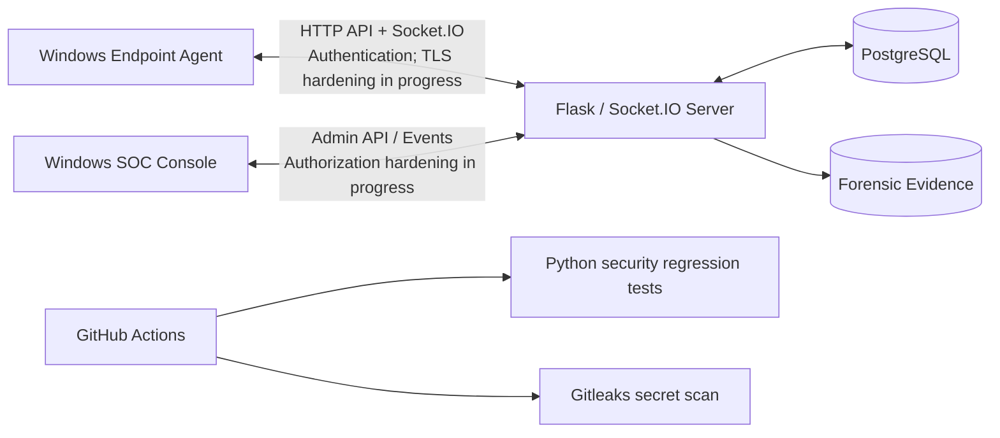

# 🛡️ FileTrack — Honeyfile-Based Endpoint Detection & Response

**FileTrack** is a Windows-focused endpoint detection and response (EDR) graduation project built around **honeyfiles (decoy files)**. It brings together an endpoint agent, a central management server, and a security operations (SOC) desktop console in one monorepo.

> **Project status: Active development / security hardening.** FileTrack is **not production-ready**. The architecture and features described here include both implemented functionality and security controls still being tested or planned. Do not deploy it to real endpoints or expose the server publicly until the outstanding security issues are resolved.

## Overview

The Windows agent monitors configured files and collects threat-related telemetry. A Flask and Socket.IO backend receives agent events, stores application data in PostgreSQL, and serves the administrative interface. A Windows desktop SOC console provides visibility into agents, alerts, and response workflows.

FileTrack is being developed alongside a **DevSecOps and cloud-security roadmap**: regression tests, secret scanning, least-privilege containerization, hardened authentication, trusted TLS, and eventually a controlled cloud deployment.

## Monorepo layout

```text
FileTrack/
├── .github/
│   └── workflows/
│       └── security-tests.yml    # CI security checks (pending first GitHub run)
├── admin/                        # Windows SOC desktop application
│   ├── app/
│   ├── assets/
│   ├── components/
│   ├── ui/
│   ├── views/
│   ├── main.py
│   ├── requirements.txt
│   └── README.md
├── agent/                        # Windows endpoint agent
│   ├── modules/
│   ├── client.py
│   ├── security.py
│   ├── setup_script.iss
│   └── README.md
├── server/                       # Central Flask / Socket.IO service
│   ├── app.py
│   ├── bootstrap_admin.py
│   ├── db_manager.py
│   ├── security.py
│   ├── Dockerfile
│   ├── requirements.txt
│   ├── templates/
│   └── README.md
├── tests/                        # Security regression tests
│   └── test_agent_safety.py
├── docker-compose.yml
├── .gitignore
└── README.md
```

For component-specific setup and behavior, see [`server/README.md`](server/README.md), [`agent/README.md`](agent/README.md), and [`admin/README.md`](admin/README.md).

## Architecture



**Transport note:** The agent code has been updated to request certificate verification, but a trusted HTTPS/WSS endpoint and corresponding client/server configuration are **not yet validated**. The diagram describes logical communication paths, not a verified secure production connection.

## Components

| Component | Technology | Purpose |
| --- | --- | --- |
| **Server** (`server/`) | Python, Flask, Flask-SocketIO, PostgreSQL | Agent registration and events, persistence, administrative APIs, and response coordination |
| **Endpoint Agent** (`agent/`) | Python, Windows APIs, watchdog/monitoring and forensic libraries | Honeyfile monitoring, telemetry, and configured response actions |
| **SOC Console** (`admin/`) | Python, CustomTkinter | Desktop views for agents, alerts, forensics, and administrative workflows |
| **Development infrastructure** | Docker Compose | Local PostgreSQL and containerized server |
| **Security checks** | `unittest`, Gitleaks, GitHub Actions | Regression checks and secret scanning |

Some response actions can change Windows firewall settings, USB availability, or file permissions. **Do not test them on your primary machine.** Containment controls are disabled by default in the current development configuration, but additional validation and recovery safeguards are still required.

## Security and DevSecOps status

| Area | Current status |
| --- | --- |
| Environment-based secrets | **Partially implemented:** server reads credentials from environment variables; agent secret provisioning needs a per-device design |
| Secret hygiene | **Locally verified:** `.env` and agent configuration are ignored by Git; Gitleaks found no secrets in the staged files at the time of the local scan |
| Docker | **Locally built/tested:** PostgreSQL container health and server-to-database authentication verified; server uses a non-root container user |
| Authentication | **In progress:** HMAC generation/verification tested locally; JWT/MFA separation improved; further authorization, enrollment, and session tests required |
| Remote shell | **Disabled in reviewed paths:** client handler rejects remote-shell execution and server emission is guarded by a static regression test |
| Agent containment | **Partially gated:** dangerous operations require explicit opt-in; path restrictions, restore behavior, and runtime tests remain |
| Automated tests | **Locally passed:** four Python static security regression tests; not a full security audit |
| GitHub Actions | **Configured, not yet verified on GitHub:** syntax checks, regression tests, Gitleaks scan |
| HTTPS/WSS and admin TLS | **Not complete:** certificate-backed endpoint and all client trust settings still need validation |
| RBAC / API authorization | **Not complete:** endpoint-level permissions and evidence access require further hardening |
| AWS deployment / cloud security | **Planned:** IAM, network segmentation, secrets management, TLS termination, monitoring, and secure deployment pipeline |

The descriptions above reflect the current development baseline; they are **not** claims of certification, enterprise readiness, or completed penetration testing.

## Local development prerequisites

- Python **3.13** for the currently used local security tests; component dependencies are specified in their respective `requirements.txt` files.
- Docker Desktop with Docker Compose for local database/server development.
- Windows for the endpoint agent and SOC console.
- Git and Gitleaks for source-control and secret-scanning checks.

### Environment configuration

Create a local `.env` file in the repository root with your **own randomly generated** values for the following keys:

```dotenv
DB_PASSWORD=<generate-locally>
AGENT_SECRET_KEY=<generate-locally>
JWT_SECRET_KEY=<generate-locally>
```

The placeholders above are illustrative only; they are **not valid secrets**. Never commit `.env`, private keys, `agent/config.json`, forensic evidence, or real credentials. Do not copy the server's full `.env` file onto endpoint devices. Before distributing agents, replace the development shared-key mechanism with secure, individual agent enrollment/credentials.

> **Safety:** Do not start the Windows agent on the host machine or expose the Flask server to the internet as part of a quick-start demonstration. A trusted TLS front end, authorization controls, and safe containment behavior still need verification.

### Non-destructive local checks

From the repository root:

```powershell
# Validate Compose configuration without printing expanded secrets
docker compose config --quiet

# Start only the PostgreSQL development service
docker compose up -d db

docker compose ps

# Check Python syntax without starting the application
python -m compileall -q admin agent server tests

# Run the static security regression suite
python -m unittest discover -s tests -p "test_*.py" -v
```

A successful syntax check or regression run does **not** establish production security. The server and agent require additional integration and security validation before being started together.

## CI security workflow

The proposed workflow lives at [`.github/workflows/security-tests.yml`](.github/workflows/security-tests.yml). It is intended to run on pushes and pull requests and currently defines two jobs:

1. **Python security regression checks** — compile selected modules and run tests from `tests/`.
2. **Gitleaks secret scanning** — scan checked-out repository files with a versioned Gitleaks release and archive checksum validation.

These checks have been exercised **locally**. The first GitHub-hosted workflow run, branch protection, and broader scanning policies are still pending. Planned additions include SAST (for example, Semgrep), dependency/container vulnerability scanning (for example, Trivy), supply-chain controls, and deployment approvals.

## Cloud security roadmap

Future deployment work includes least-privilege cloud identities, restricted inbound access, private database networking, managed or carefully protected secrets, validated HTTPS/WSS, encrypted storage and backups, audit logging, patching, and controlled CI/CD deployment. **No AWS production deployment is claimed at this stage.**

## Known limitations and safe-use guidance

- Administrative RBAC and API/evidence authorization need further review.
- Some Admin requests still need TLS certificate verification fixes.
- The development agent authentication scheme uses a shared secret; it is not suitable for large-scale endpoint enrollment.
- Network/USB containment and file-permission changes require more reliable rollback and stronger runtime safeguards.
- Forensic collection may capture sensitive data; testing should use isolated systems, authorized accounts, and synthetic evidence.
- Local static tests and secret scans do not replace integration tests, threat modeling, dependency audits, or penetration testing.

**Use only in environments you control and are authorized to test.** Prefer a disposable Windows virtual machine for agent testing.

## Project documentation

- [Server documentation](server/README.md)
- [Agent documentation](agent/README.md)
- [Admin console documentation](admin/README.md)
- [Security test suite](tests/test_agent_safety.py)
- [GitHub Actions workflow](.github/workflows/security-tests.yml)

## Author

**Youssif Ahmed Yehia** — FileTrack graduation project / DevSecOps and security development.

---

*FileTrack is a development-stage security engineering project. Security claims are updated as controls are implemented and verified.*
