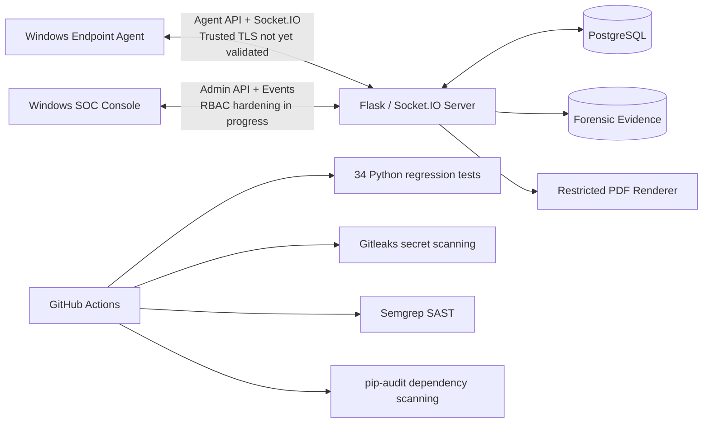

# 🛡️ FileTrack — Honeyfile-Based Endpoint Detection & Response

**FileTrack** is a Windows-focused endpoint detection and response (EDR) graduation project built around **honeyfiles (decoy files)**. The monorepo combines a Windows endpoint agent, a central Flask/Socket.IO management server backed by PostgreSQL, and a Windows security operations (SOC) desktop console.

> **Status (November 2026): Active development / security hardening — not production-ready.** The local security regression suite has **34 passing tests**, and the latest reviewed GitHub Actions run (**Run #7**) passed all **four security jobs**. These results validate the tested checks, **not** end-to-end security, secure enrollment, or production deployment. Do not install the agent on a primary workstation or expose the server publicly.

## Overview

The endpoint agent monitors configured files, detects relevant changes, and can collect evidence under configured response policies. The server receives agent events, stores incident metadata in PostgreSQL, manages administrative endpoints, and generates incident PDF reports. The SOC console presents agents, events, and investigation/response workflows.

Current engineering priorities are **secure agent identity and authorization**, robust evidence integrity, trusted HTTPS/WSS, and controlled integration testing. A cloud deployment remains part of the future roadmap, **not a completed feature**.

## Monorepo layout

```text
FileTrack/
├── .github/
│   └── workflows/
│       └── security-tests.yml     # Four GitHub Actions security jobs
├── admin/                         # Windows SOC desktop application
│   ├── app/
│   ├── assets/
│   ├── components/
│   ├── ui/
│   ├── views/
│   ├── main.py
│   ├── requirements.txt
│   └── README.md
├── agent/                         # Windows endpoint agent
│   ├── modules/
│   │   └── watcher.py             # Honeyfile event handling / evidence flow
│   ├── client.py
│   ├── security.py
│   ├── setup_script.iss
│   └── README.md
├── server/                        # Flask / Socket.IO / PostgreSQL service
│   ├── app.py
│   ├── bootstrap_admin.py
│   ├── db_manager.py
│   ├── pdf_renderer.py            # Restricted-resource PDF generation
│   ├── security.py
│   ├── Dockerfile
│   ├── requirements.txt
│   ├── templates/
│   └── README.md
├── tests/
│   ├── test_agent_safety.py
│   ├── test_agent_evidence_flow.py
│   ├── test_atomic_evidence_association.py
│   ├── test_evidence_path_safety.py
│   ├── test_pdf_endpoint.py
│   ├── test_pdf_renderer.py
│   └── test_threat_logging.py
├── docker-compose.yml
├── .gitignore
└── README.md
```

For component-specific details, see [`server/README.md`](server/README.md), [`agent/README.md`](agent/README.md), and [`admin/README.md`](admin/README.md). These component documents may need separate updates as development proceeds.

## Architecture



**Transport note:** Selected agent and admin HTTP clients now request certificate verification, but an end-to-end trusted HTTPS/WSS deployment and Socket.IO authorization have **not** been validated. The diagram is logical, not a claim of an operational secure production connection.

## Components

| Component | Technology | Purpose |
| --- | --- | --- |
| **Server** (`server/`) | Python, Flask, Flask-SocketIO, PostgreSQL | Agent registration, incident persistence, administrative APIs, evidence handling, PDF reports, and response coordination |
| **Endpoint Agent** (`agent/`) | Python, Windows APIs, filesystem monitoring and forensic modules | Honeyfile monitoring, event telemetry, evidence collection, and policy-controlled actions |
| **SOC Console** (`admin/`) | Python, CustomTkinter | Desktop dashboards for agents, incidents, evidence, and administrative workflows |
| **Development infrastructure** | Docker Compose | Local containerized server and PostgreSQL, with database access restricted in the reviewed Compose configuration |
| **Security checks** | `unittest`, Gitleaks, Semgrep, `pip-audit`, GitHub Actions | Regression testing, secret scanning, static analysis, and Python dependency auditing |

**Safety:** Some response policies can modify files, permissions, network access, USB availability, or collect sensitive evidence. Containment is gated by an explicit opt-in in the reviewed implementation and must remain disabled during ordinary development. Do **not** exercise the agent or its playbooks on a primary machine.

## Implemented security and DevSecOps work

| Area | Verified or implemented baseline | Remaining qualification |
| --- | --- | --- |
| **Security CI** | Four GitHub Actions jobs passed in the last reviewed Run #7 | Branch protections, deployment gates, and deeper supply-chain assurance not established |
| **Regression testing** | **34/34 tests passed locally and on GitHub Actions**; covers safety guards, JWT-related behaviors, PDF restrictions, evidence paths, incident linkage, and simulated failure cases | Most tests use AST extraction, Flask test clients, and mocks; not full live integration |
| **Secret scanning** | Gitleaks runs in CI with a versioned/checksummed release; reviewed run passed | Passing scan cannot guarantee no secrets exist anywhere |
| **SAST** | Semgrep `p/security-audit` runs against application code in CI; reviewed run passed | Static analysis is not a complete code audit |
| **Dependency scanning** | `pip-audit` checks `server/requirements.txt` and `admin/requirements.txt` in CI; reviewed run passed | Agent dependencies, containers, and OS packages need dedicated coverage |
| **Container hardening** | Server image built/tested locally; process uses a non-root user; PostgreSQL configured for development use | Runtime sandboxing, Compose hardening, cloud deployment, and network policy need further validation |
| **Authentication** | Admin JWT and MFA claim handling strengthened; HMAC-based agent token verification in place | Shared agent secret does **not** authenticate individual devices; RBAC and Socket.IO auth need review |
| **Remote shell** | Remote-shell execution disabled in reviewed agent/server paths and covered by regression tests | Additional command/task pathways still require authorization review |
| **Containment** | Certain dangerous response actions require explicit opt-in | Windows permission changes, recovery, and isolated VM testing remain necessary |
| **Incident evidence linkage** | Agent registers incident first, receives PostgreSQL `log_id`, and uploads evidence against that ID; server checks incident/agent association | Shared-token impersonation, orphan files, and real concurrency scenarios remain risks |
| **Evidence upload** | Request size limit, filename checks, exclusive file publication, pre-validation of incident, and database attachment handling | No complete transactional file/DB commit; cleanup/reconciliation policy still needed |
| **PDF reporting** | Replaced `pdfkit`/local-file access with WeasyPrint and restricted external resources; embedded images validated and bounded | Broader rendering and operational tests are still required |
| **HTTPS/WSS** | Clients configured to request certificate verification in reviewed code | Trusted certificate-backed end-to-end deployment not verified |
| **Cloud security** | Planning and limited local container controls | No validated AWS production deployment, cloud IAM, or cloud threat-monitoring setup |

### Evidence-to-incident association flow

The current code implements this logical sequence:

```mermaid
sequenceDiagram
    participant A as Windows Agent
    participant S as Flask API
    participant D as PostgreSQL
    A->>A: Detect event and collect evidence locally
    A->>S: POST /api/v1/log_threat
    S->>D: Insert threat log
    D-->>S: Numeric log_id
    S-->>A: 200 + log_id
    A->>S: POST /api/v1/upload_artifact (log_id, agent_id, file)
    S->>D: Pre-check incident and agent association
    S->>S: Publish evidence file exclusively
    S->>D: Lock incident row; append evidence; commit
    S-->>A: Upload outcome
```

This replaces the earlier behaviors of attaching evidence to the **latest incident** or collecting **all files modified within 60 seconds**. The database attachment function uses a transaction and `SELECT ... FOR UPDATE`, with unit tests for the query/commit/rollback path.

**Limitations:** `agent_id` remains client-supplied and is not cryptographically bound to an individual agent credential. The pre-check and final DB update do not make the filesystem and database a single transaction: failed attachments can still leave orphan files. Real PostgreSQL concurrent-upload testing and credential-bound authorization are pending. The earlier automatic screenshot-analysis trigger tied to the 60-second file list was removed; it needs an incident-specific design before re-enablement.

### PDF report hardening

Incident PDF generation now uses [`server/pdf_renderer.py`](server/pdf_renderer.py) with **WeasyPrint**, rather than `pdfkit` with unrestricted local-file access. The renderer blocks external resources and allows bounded embedded PNG/JPEG data URIs. Report preparation also validates image paths and formats before embedding them. A containerized PDF-render smoke test succeeded locally; this is **not** a complete runtime security assessment.

## Current priority: per-agent authentication

The present agent/server token is an HMAC-SHA256 digest of a **five-minute time window**, derived from the environment-provided `AGENT_SECRET_KEY`. The server compares the submitted token with the expected current-window token. All devices sharing that secret can produce the same token; the token does **not** identify which device sent a request, nor does it prevent replay within the window.

Relevant risk areas identified during code review:

- `/api/v1/register` accepts a client-supplied `agent_id` after shared-token verification; database registration uses an upsert.
- `/api/v1/heartbeat` uses the submitted `agent_id` to update a device and retrieve `active_tasks.pop(agent_id, None)`.
- Incident creation and evidence upload also use an `agent_id` supplied by the requester.
- Socket.IO agent connections and task dispatch require a separate identity/authorization review.

**Planned remediation (not implemented):** approved device enrollment; unique, revocable credentials per agent; server-derived authenticated identity; explicit authorization on registration, heartbeat, incidents, evidence, tasks, and Socket.IO; credential rotation and replay resistance. Simply adding `agent_id` to an HMAC generated with a shared key is **not** sufficient.

## Local development prerequisites

- Python **3.13** for the currently reviewed local regression environment (the CI job also uses Python 3.13).
- Windows for the endpoint agent and SOC console.
- Docker Desktop / Docker Compose for optional isolated local infrastructure development.
- Git; component-specific Python dependencies are defined in the corresponding `requirements.txt` files.

### Environment configuration

Use **locally generated secrets**, supplied through a protected development environment or a Git-ignored `.env` where applicable. For example:

```dotenv
DB_PASSWORD=<generate-locally>
AGENT_SECRET_KEY=<generate-locally-at-least-32-characters>
JWT_SECRET_KEY=<generate-locally>
```

These are placeholders, **not valid credentials**. Never commit `.env`, real tokens, private keys, `agent/config.json`, forensic evidence, or production data. Do not distribute the server's entire environment file to endpoints. The current shared agent secret is **development-only** and must be replaced before real endpoint rollout.

### Non-destructive local checks

From the repository root, inside an appropriately configured Python virtual environment:

```powershell
# Syntax checks only; do not start the server or agent
python -m py_compile .\server\app.py .\server\db_manager.py .\agent\modules\watcher.py

# Isolated regression suite (mocks / test clients; no live agent required)
python -m unittest discover -s tests -p "test_*.py" -v

# Git whitespace validation
git diff --check

# Compose validation, without starting containers (optional)
docker compose config --quiet
```

The test environment needs the dependencies used by the suite (including Flask, PyJWT, Pillow, WeasyPrint, and `requests`). The CI workflow installs its own required test dependencies. Some tests intentionally log simulated exceptions while still passing; rely on the final `OK` / exit status and individual assertions, not the absence of error messages.

**Do not** start the Windows agent, run response playbooks, or expose the Flask server as part of a quick-start verification. Authorized, disposable test environments and explicit safety controls are required for live integration tests.

## CI security workflow

The workflow at [`.github/workflows/security-tests.yml`](.github/workflows/security-tests.yml) runs on repository events configured in that file and currently has **four jobs**:

1. **Security regression tests:** Python syntax checks and `unittest` discovery; **34 tests passed** in the reviewed GitHub run.
2. **Gitleaks secret scanning:** scans repository content with a pinned release and verified download checksum.
3. **Semgrep SAST:** static security-audit rules against application code.
4. **Dependency scanning:** `pip-audit` on the **server and admin** Python requirements.

**Last reviewed result:** GitHub Actions **Run #7 — all 4 jobs successful** after adding `requests` to the regression job dependencies. The number of tests and run status refer to that observed result; subsequent runs may differ.

Passing CI does **not** establish that the full application has been penetration-tested or that a deployment is safe. Container scanning, agent dependency coverage, repository protections, deployment approvals, and integration/security tests remain future work.

## Cloud security roadmap

No completed AWS production deployment is claimed. Planned work includes least-privilege IAM identities, restricted inbound access and segmented/private networking, reliable secrets provisioning/rotation, trusted HTTPS/WSS, encryption and backups, centralized logs and alerting, image and infrastructure scanning, patching, and an approval-gated delivery pipeline. Any infrastructure validation should take place in an authorized, isolated test environment.

## Known limitations and safe-use guidance

- **Per-agent authentication and enrollment are not implemented.** The shared HMAC token can permit agent ID spoofing and unauthorized access to another agent's incident/task context if the secret is known.
- **Task authorization needs hardening:** `/heartbeat` looks up tasks using client-supplied `agent_id`; `active_tasks` is an in-memory store, not a durable audited queue.
- **Socket.IO and admin authorization require review:** authenticated room joins, RBAC, role-based task permissions, and session lifecycle enforcement are not yet fully established.
- **Orphan evidence remains possible:** a file can be published before the final database association fails. File/DB reconciliation, retention, and cleanup need a defined design.
- **Real integration tests are outstanding:** unit tests with mocks do not prove PostgreSQL concurrency behavior, full server-to-agent protocol compatibility, or trusted TLS/WSS connectivity.
- **Incident delivery is not fully idempotent:** a lost HTTP response after a committed incident can leave local evidence unuploaded or cause duplicates during future retries unless event IDs and retry semantics are designed.
- **Evidence type is inferred from filename prefixes** in the reviewed upload endpoint; it should be checked against an explicit, validated evidence schema.
- **Forensic data may be sensitive:** evidence should be minimized, controlled, auditable, and retained only as justified.
- **Windows response actions are high-risk:** network/USB containment, `icacls` permission changes, and file recovery require isolated tests, rollback plans, and explicit authorization.
- **Cloud controls remain planned**, not deployed or independently verified.

**Use only in environments you own or are authorized to test.** Prefer disposable Windows VMs, synthetic incidents/evidence, and a dedicated development database. Do not enable containment or run the EDR agent on a primary computer.

## Project documentation

- [Server documentation](server/README.md)
- [Agent documentation](agent/README.md)
- [Admin console documentation](admin/README.md)
- [Security tests](tests/)
- [GitHub Actions workflow](.github/workflows/security-tests.yml)

## Author

**Youssif Ahmed Yehia** — FileTrack graduation project / DevSecOps and security development.

---

*FileTrack is a development-stage security engineering project. The status above records reviewed implementation and test results as of November 2026; it is not a certification or a production-readiness claim.*
