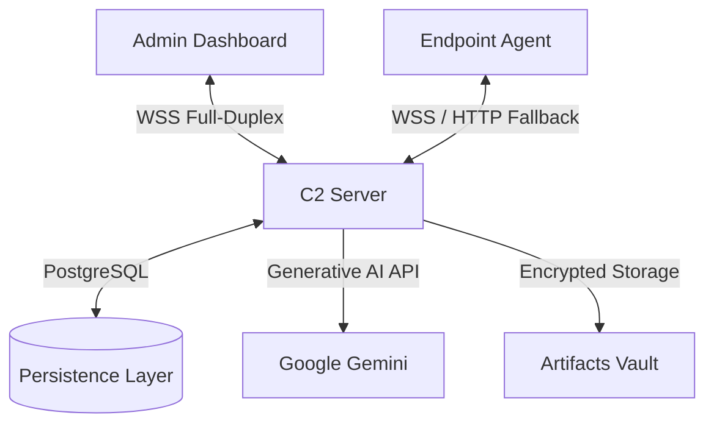
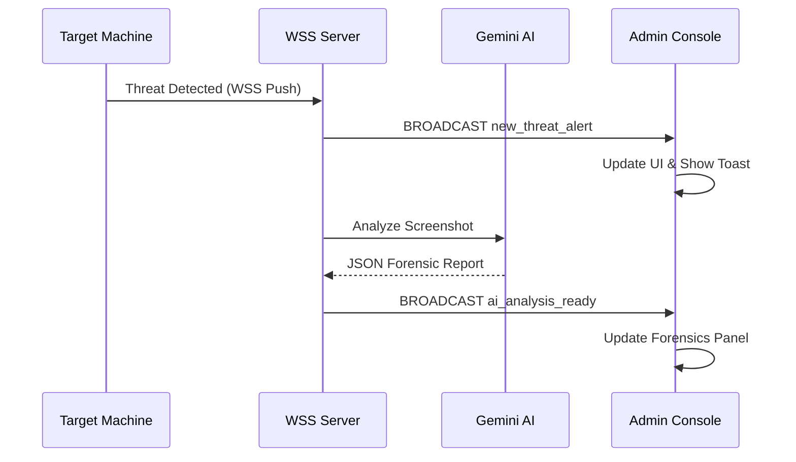

# 🛡️ FileTrack EDR — Admin Dashboard (Pro Version)

> **Intelligence-Driven Endpoint Detection & Response (EDR) Console** Real-Time Monitoring • AI Forensics • Zero-Latency Response

[](https://github.com/Youssifa7med/admin-filetrack-with-GUI/releases/latest)
**[📥 Direct Download: FileTrack Console Setup v1.0.0 (.exe)](https://github.com/Youssifa7med/admin-filetrack-with-GUI/releases/download/v1.0.0/FileTrack_Console_Setup.exe)**

---
# 🌟 Overview

**FileTrack EDR Admin Dashboard** is a high-performance **Security Operations Center (SOC)** console engineered for real-time cyber defense.

Unlike traditional polling-based monitoring systems, the **Pro Version** implements a **Full-Duplex Secure WebSocket (WSS)** architecture, enabling:

- ⚡ **Zero-Latency Monitoring**
- 🤖 **AI-Powered Threat Forensics**
- 📡 **Real-Time Incident Streaming**
- 🛡️ **Instant Response Automation**

The dashboard integrates **Google Gemini AI**, allowing automatic forensic analysis of intercepted threats — enabling analysts to understand attacker intent **within seconds**.

---

# ✨ Core Capabilities

## 🚀 Zero-Latency Monitoring (WSS-Based)

- Real-time agent connectivity status
- Instant Online / Offline detection
- Continuous Heartbeat telemetry
- No refresh required
- Fully event-driven architecture

---

## 🤖 AI-Powered Forensics

Automated incident analysis using **Google Gemini AI**.

The system collects:

- 📸 Desktop Screenshots
- 🎥 Webcam Snapshots
- 🎤 Microphone Audio
- 📄 Process Metadata

Gemini generates:

- Threat Summary
- Attack Behavior Analysis
- Recommended Containment Actions

---

## ⚡ Live Threat Feed

Reactive security event stream.

Features:

- Real-time incident feed
- Zero refresh UI updates
- Native Windows Toast notifications
- Policy violation alerts

---

## 📂 Remote 0-Delay File Explorer

Browse endpoint file systems instantly.

Powered by:

- Secure WebSocket streaming
- Real-time directory listing
- Remote file preview
- High-speed artifact retrieval

Performance:

**Up to 10× faster than HTTP polling**

---

## 🛡️ Dynamic Response Engine

Automated **Security Playbooks**.

Severity Levels:

- 🟢 Low
- 🟡 Medium
- 🟠 High
- 🔴 Critical

Supported Actions:

- Host Isolation
- Process Termination
- Honeyfile Restoration
- Evidence Collection

---

## 📊 Real-Time Analytics

Dynamic live telemetry visualization.

Includes:

- Security Score Engine
- Threat Distribution Charts
- Incident Timeline
- Risk Metrics Dashboard

---

## 🔐 Enterprise IAM

Multi-user role-based security model.

Roles:

- **SuperAdmin**
- **Security Analyst**
- **Forensic Expert**

Capabilities:

- Role-Based Access Control (RBAC)
- JWT Authentication
- Secure Session Management

---

# 🧠 System Architecture



---

# 📡 Technical Stack

## Frontend

- CustomTkinter
- Pillow
- Native Windows UI Components

## Real-Time Communication

- python-socketio
- eventlet
- WebSocket (WSS)

## Intelligence Layer

- google-generativeai
- Gemini Flash
- Gemini Pro

## Networking

- requests
- urllib3

## Notifications

- winotify
- Windows Native Toasts

## Security

- PyJWT
- SSL/TLS
- Secure Token Authentication

---

# 🛠️ Installation & Setup

## 📥 Option 1: Download Pre-compiled Setup (Recommended for Windows)
You don't need to install Python or any dependencies. Simply download the ready-to-use installer directly:
👉 **[Download FileTrack_Console_Setup.exe](https://github.com/Youssifa7med/admin-filetrack-with-GUI/releases/download/v1.0.0/FileTrack_Console_Setup.exe)**

*(Note: Run the `.exe` and follow the on-screen instructions to install the Admin Console on your machine.)*

---

## 💻 Option 2: Run from Source (For Developers)

### 📋 Prerequisites
- Python **3.10+**
- Active **FileTrack C2 Server**
...

## 📦 Clone Repository

```bash
git clone https://github.com/Youssifa7med/admin-filetrack-with-GUI

cd admin-filetrack-with-GUI
```

---

## 📥 Install Dependencies

```bash
pip install customtkinter
requests
python-socketio
websocket-client
winotify
Pillow
google-generativeai
urllib3
```

---

## 🚀 Launch Dashboard

```bash
python main.py
```

---

# 🔐 Security Features

## 🧩 WebSocket VIP Room

After authentication:

1. Admin logs in via REST API
2. Server issues JWT token
3. Token upgrades connection to Secure WebSocket
4. Admin joins:

```
admins_room
```

Only authorized administrators receive:

- Real-time threat broadcasts
- Sensitive telemetry
- AI forensic reports

---

## 🛡️ Response Playbooks

Global defense automation modes.

### Auto-Revert

Restores modified honeyfiles using:

- Stored cryptographic hashes
- Pre-attack state restoration

---

### Host Isolation

Immediately disconnects infected endpoint.

Actions:

- Disable network interface
- Block outbound traffic
- Prevent lateral movement

---

### Evidence Collection

Triggered automatically.

Captures:

- Screenshots
- Running processes
- Memory artifacts
- Suspicious files

---

# 📈 Real-Time Incident Lifecycle



---


---

# 🔮 Roadmap

## Completed

- Full WebSocket Integration
- Gemini AI Forensic Analysis
- Remote File Explorer
- Threat Feed Engine
- Response Playbooks

---

## Upcoming Features

- 🌐 Network Topology Live Map
- 🖥️ Multi-Host Bulk Deployment
- 🔔 Discord Webhook Alerts
- 📱 Telegram Bot Integration
- 🧠 Predictive Threat Intelligence

---

# 🧪 Testing Strategy

Includes:

- Unit Testing
- Integration Testing
- WSS Load Testing
- Failover Simulation

Recommended Tools:

- pytest
- locust
- Wireshark

---

# 📜 License

This project is licensed under:

**MIT License**

---

# 🧠 Author

**FileTrack EDR Development Team**

Cyber Defense • Threat Intelligence • Digital Forensics

---

# ⭐ Final Note

**FileTrack EDR** is not just a monitoring tool — it is a **real-time cyber defense platform** built for modern threat landscapes.

> Intelligence First. Response Instant. Defense Continuous.

---
