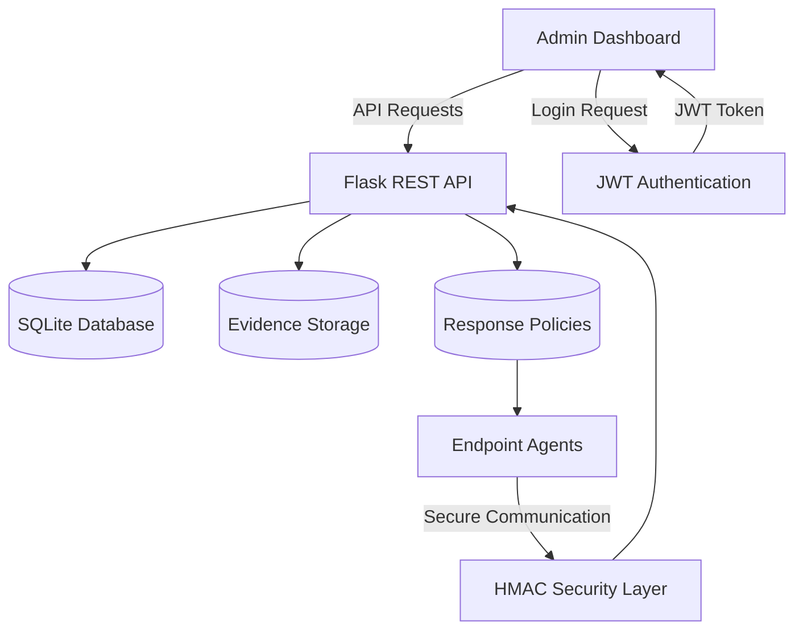
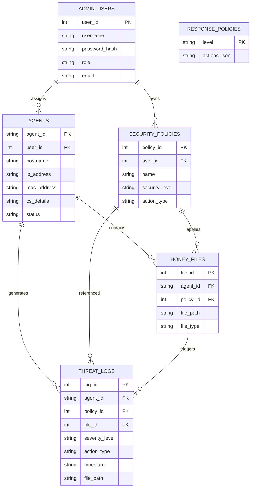
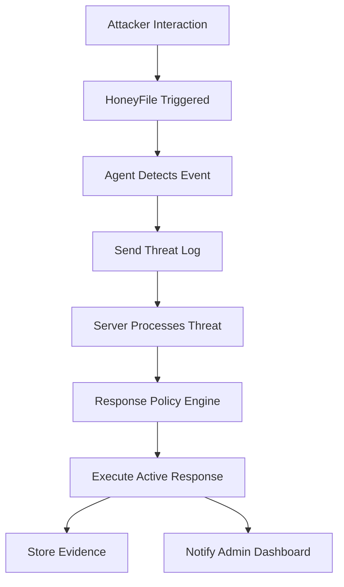
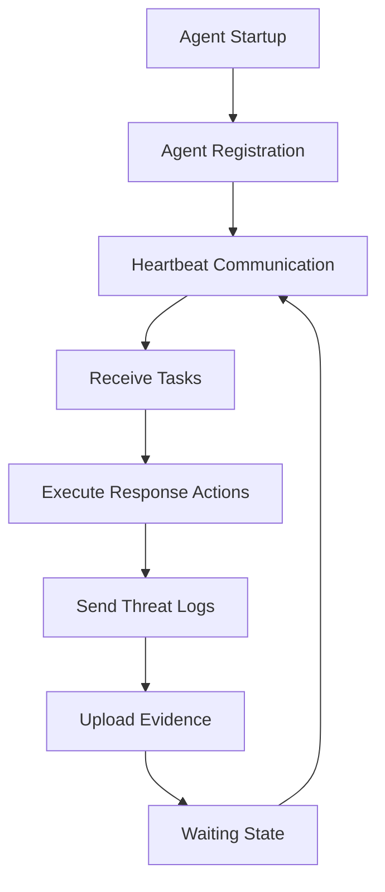
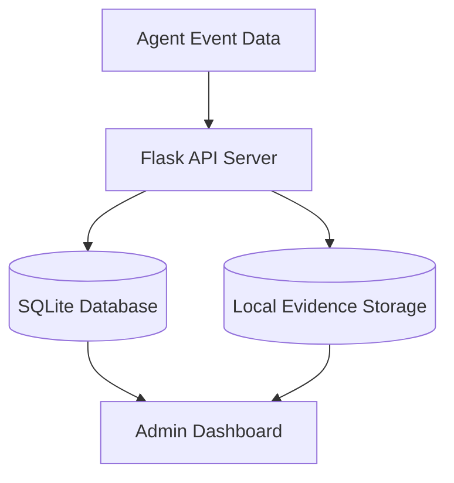
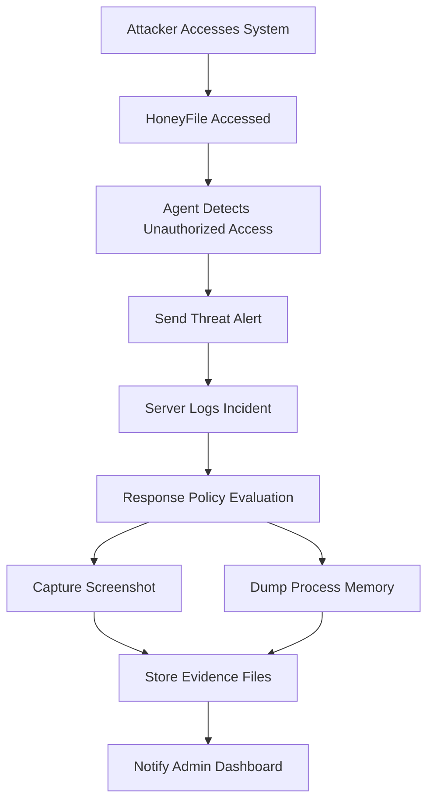

## 🔑 JWT-Based Admin Authentication

The FileTrack C2 Server implements a secure **JSON Web Token (JWT)** authentication mechanism to protect all administrative operations performed through the Admin Dashboard.

This ensures that only authenticated administrators can access sensitive resources such as agent data, threat intelligence, response policies, and honeyfile deployment.

---

## 🛡️ Authentication Workflow

The Admin authentication process follows a secure token-based model:

1. The administrator submits login credentials through the Admin API.
2. The server verifies the credentials against securely hashed passwords stored in the database.
3. If authentication succeeds:

   * A **JWT access token** is generated.
   * The token includes:

     * Administrator identity
     * Expiration timestamp
4. The token must be included in all subsequent Admin API requests.
5. Each protected route validates the token before granting access.

---

## 🔐 Admin Login Endpoint

### Request

```http
POST /api/v1/admin/login
Content-Type: application/json
```

```json
{
  "username": "admin",
  "password": "example_password"
}
```

---

### Successful Response

```json
{
  "status": "success",
  "token": "example.jwt.token.string"
}
```

---

### Failed Authentication Response

```json
{
  "error": "Invalid credentials"
}
```

---

## 🧪 Using JWT in Protected Requests

All Admin API requests must include the JWT token in the request header:

```http
X-Admin-Token: YOUR_JWT_TOKEN
```

Example:

```http
GET /api/v1/admin/agents
X-Admin-Token: example.jwt.token.string
```

---

## 🔒 Protected Admin Endpoints

The following endpoints require a valid JWT token:

```text
GET    /api/v1/admin/agents
GET    /api/v1/admin/threats
DELETE /api/v1/admin/threats
POST   /api/v1/admin/set_task
GET    /api/v1/admin/get_browse_results/<agent_id>
GET    /api/v1/admin/policies
POST   /api/v1/admin/policies
POST   /api/v1/admin/honeyfiles
GET    /api/v1/admin/honeyfiles
DELETE /api/v1/admin/honeyfiles
```

---

## ⏳ Token Expiration Handling

JWT tokens are configured with an expiration duration to enhance security.

Typical behavior includes:

* Tokens automatically expire after a fixed time period.
* Expired tokens are rejected by the server.
* Administrators must re-authenticate to obtain a new token.
* Invalid or tampered tokens are denied access immediately.

---

## 🔐 Password Security

Administrator credentials are securely handled using:

* Password hashing before database storage
* Secure password verification during login
* Protection against plaintext credential storage

This ensures strong authentication hygiene and protects administrative accounts from compromise.

---

## 🛡️ Security Benefits of JWT Authentication

Implementing JWT-based authentication provides:

* Stateless authentication model
* Reduced session management complexity
* Secure access control to administrative resources
* Protection against unauthorized dashboard access
* Improved scalability for distributed deployments

This mechanism strengthens the overall security posture of the FileTrack C2 Server infrastructure.

---

# 🧠 System Architecture Diagram



This diagram illustrates how administrators, agents, and system components interact through secure communication channels.

---

# 🔐 Security Model Section

The FileTrack C2 Server follows a **layered security model** designed to enforce strong authentication and prevent unauthorized access.

## Security Layers

### 1️⃣ Agent Authentication (HMAC-Based)

* Uses time-based rolling tokens
* Prevents replay attacks
* Validates agent identity
* Rejects unauthorized communication

### 2️⃣ Admin Authentication (JWT-Based)

* Secure login authentication
* Stateless session management
* Token expiration enforcement
* Protected Admin API access

### 3️⃣ Secure Transport (HTTPS)

* All communications use encrypted HTTPS
* SSL/TLS certificates required in production
* Prevents packet sniffing and MITM attacks

### 4️⃣ Password Security

* Password hashing before storage
* No plaintext credentials stored
* Secure verification during login

---

# 📊 Database ERD Section



This ERD accurately reflects the full relational structure defined in the FileTrack database schema, including all foreign key dependencies and policy relationships.

---

# 🧪 API Testing with Postman

The FileTrack API can be tested using **Postman** for validating authentication and endpoint functionality.

## Recommended Testing Steps

### Step 1 — Login Request

```http
POST /api/v1/admin/login
Content-Type: application/json
```

Body:

```json
{
  "username": "admin",
  "password": "example_password"
}
```

Expected Output:

```json
{
  "status": "success",
  "token": "example.jwt.token.string"
}
```

---

### Step 2 — Access Protected Endpoint

```http
GET /api/v1/admin/agents
X-Admin-Token: example.jwt.token.string
```

Expected Output:

```json
{
  "status": "success",
  "data": []
}
```

---

# 🐳 Docker Deployment Guide

Docker enables containerized deployment of the FileTrack C2 Server.

## Dockerfile Example

```dockerfile
FROM python:3.10-slim

WORKDIR /app

COPY . .

RUN pip install Flask werkzeug requests urllib3 pyjwt

EXPOSE 5000

CMD ["python", "app.py"]
```

---

## Build Docker Image

```bash
docker build -t filetrack-c2 .
```

---

## Run Docker Container

```bash
docker run -d -p 5000:5000 filetrack-c2
```

---

# 📈 Threat Response Flow Diagram



This flow describes how the system detects threats, applies response logic, and records forensic evidence.

---

# 🚀 Installation & Deployment Guide

This section provides a **production-grade installation workflow** for deploying the FileTrack C2 Server securely and reliably.

---

## 📦 System Requirements

Before installation, ensure the target system meets the following requirements:

* **Operating System:** Linux Server (Ubuntu 22.04 LTS recommended)
* **Python Version:** Python 3.8+
* **RAM:** Minimum 2 GB (4 GB recommended)
* **Disk Space:** Minimum 10 GB (for forensic evidence storage)
* **Network:** Public IP or domain (recommended for production)

---

## 🧰 Step 1 — Clone Repository

```bash
git clone https://github.com/Youssifa7med/server-filetrack.git
cd server-filetrack
```

---

## 🧪 Step 2 — Create Virtual Environment

Using a Python virtual environment is strongly recommended for dependency isolation.

```bash
python3 -m venv venv
source venv/bin/activate
```

---

## 📚 Step 3 — Install Dependencies

Install required Python packages:

```bash
pip install Flask werkzeug requests urllib3 pyjwt
```

Optional (recommended for production logging):

```bash
pip install gunicorn
```

---

## ⚙️ Step 4 — Configuration Setup

Create a configuration file named:

```text
config.json
```

Example configuration:

```json
{
  "secret_key": "example_secure_token"
}
```

Important Notes:

* Use a **strong random key** in production.
* Never expose real keys in public repositories.

---

## 🗄️ Step 5 — Database Initialization

The SQLite database and required tables are automatically created on first execution.

Generated directories:

```text
database/
evidence/
```

These directories store:

* Database records
* Forensic artifacts
* Screenshots
* Memory dumps
* Media recordings

---

## 🔐 Step 6 — Configure SSL Certificates (Production)

Secure communication requires valid SSL certificates.

Recommended method:

```bash
sudo apt install certbot
sudo certbot certonly --standalone -d your-domain.com
```

Expected certificate paths:

```text
/etc/letsencrypt/live/your-domain/fullchain.pem
/etc/letsencrypt/live/your-domain/privkey.pem
```

---

## ▶️ Step 7 — Run Server (Development Mode)

```bash
python app.py
```

Development Mode Features:

* Debug-friendly execution
* Local testing environment
* Fast iteration cycles

---

## 🏭 Step 8 — Production Deployment (Systemd Service)

Create service file:

```bash
sudo nano /etc/systemd/system/filetrack.service
```

Example configuration:

```ini
[Unit]
Description=FileTrack C2 Server
After=network.target

[Service]
User=root
WorkingDirectory=/opt/server-filetrack
ExecStart=/opt/server-filetrack/venv/bin/python app.py
Restart=always

[Install]
WantedBy=multi-user.target
```

Enable and start service:

```bash
sudo systemctl daemon-reload
sudo systemctl enable filetrack
sudo systemctl start filetrack
```

Check service status:

```bash
sudo systemctl status filetrack
```

---

## 🐳 Optional — Docker-Based Deployment

Docker enables fast, portable deployment across environments.

### Build Docker Image

```bash
docker build -t filetrack-c2 .
```

### Run Container

```bash
docker run -d -p 5000:5000 filetrack-c2
```

---

## 🔍 Post-Installation Verification

After deployment, verify system functionality:

1. Access Admin login endpoint
2. Register test agent
3. Send heartbeat request
4. Upload test artifact
5. Confirm database logging

Successful verification confirms full system readiness.

---

## 🧠 Deployment Best Practices

For maximum reliability and security:

* Always run behind HTTPS
* Use strong authentication keys
* Backup the database regularly
* Monitor disk usage (evidence growth)
* Use firewall rules to restrict access
* Rotate credentials periodically

Following these practices ensures long-term system stability and security.

---

# 🔄 Agent Lifecycle Diagram



This lifecycle illustrates the continuous communication loop between endpoint agents and the C2 server, ensuring persistent monitoring and rapid threat response.

---

# 🗄️ Hybrid Storage Architecture



## Storage Model Overview

The FileTrack system implements a **hybrid storage model** designed to optimize performance and scalability:

### Metadata Storage (SQLite)

Stored data includes:

* Agent registration details
* Threat logs metadata
* Policy configurations
* Honeyfile records
* Authentication data

### Evidence Storage (Filesystem)

Stored artifacts include:

* Screenshots
* Memory dumps
* Screen recordings
* Microphone recordings
* Camera captures
* Process tree JSON dumps

This hybrid approach reduces database load while maintaining efficient forensic evidence handling.

---

# 📈 Threat Simulation Scenario

This section demonstrates a **realistic cyber attack workflow simulation**, showing how FileTrack detects and responds to malicious behavior.

## Example Scenario — HoneyFile Ransomware Trigger



## Threat Response Timeline

Typical execution flow:

1. Attacker interacts with a monitored HoneyFile.
2. The endpoint agent detects suspicious activity.
3. The agent reports the event to the C2 server.
4. The server evaluates predefined response policies.
5. Active response actions are triggered automatically.
6. Evidence artifacts are collected and stored.
7. The administrator is notified through the dashboard.

This simulation demonstrates the end-to-end detection and response capabilities of the FileTrack platform, making it suitable for cybersecurity demonstrations, portfolio showcases, and academic defenses.